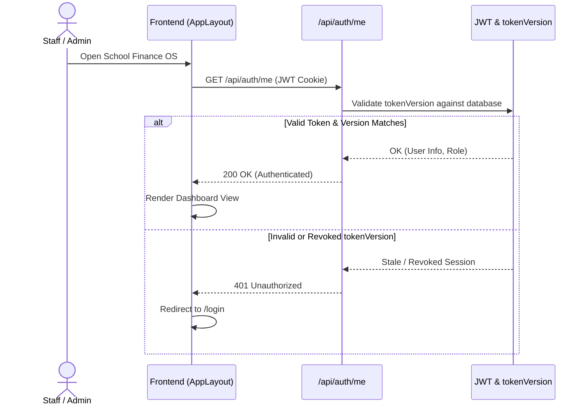
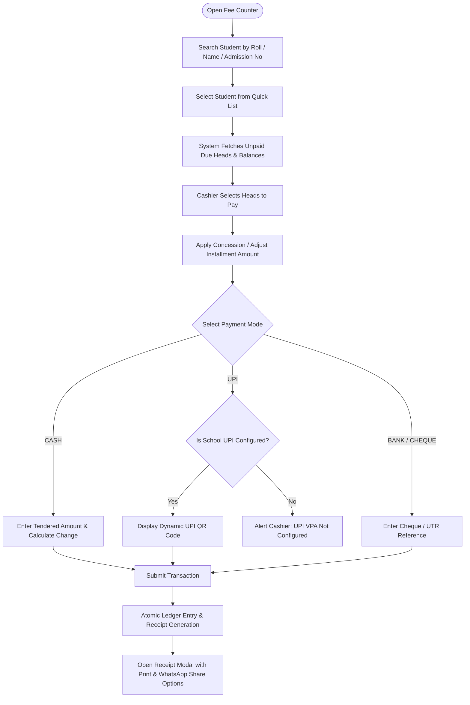
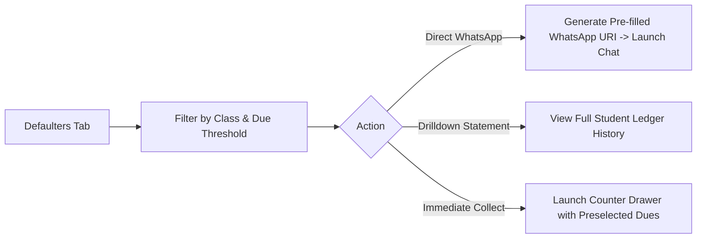

# Application Flow & Navigation Architecture
## Project: School Finance OS

---

## 1. Authentication & Session Flow



---

## 2. Navigation Hierarchy & Role Access

### 2.1 Role-Based Tab Mapping
- **ADMIN Role**:
  - `overview`: High-level financial KPIs, revenue charts, today's collections, birthdays, scratchpad.
  - `collect`: Fee Counter & Cashier Desk (Shared unified engine).
  - `students`: Student Directory, sibling linkage, profile management.
  - `defaulters`: Defaulters Tracking, aging analysis, WhatsApp alerts.
  - `ledger`: General Voucher Register, Daybook tallying.
  - `attendance`: Daily Roll Call and Monthly Register.
  - `marks`: Student Marks Entry and Evaluation Console.
  - `print_marksheets`: Comprehensive academic report card printer.
  - `structures`: Fee Structure Setup & Class mappings.
  - `users`: User Security, Staff accounts, credential management.
  - `settings`: School Profile, UPI VPA configuration, academic session setup.
- **ACCOUNTANT Role**:
  - Full operational access to cashiering, directory, attendance, marks, and defaulters without artificial bottlenecks.

---

## 3. End-to-End Fee Collection Flow



---

## 4. Defaulters Recovery & WhatsApp Flow



---

## 5. Marks Feeding & Exam Locking Flow

```mermaid
flowchart TD
    MarksTab[Marks Feeding Console] --> PickExam[Select Class, Exam & Subject]
    PickExam --> CheckLock{Is Exam Locked in School Settings?}
    CheckLock -->|Yes| ReadOnlyMode[Display Gold Lock Banner, Inputs Disabled]
    CheckLock -->|No| InteractiveMode[Enable Rapid Marks Input Grid]
    InteractiveMode --> LocalDraft[Auto-save Draft to LocalStorage]
    InteractiveMode --> SaveSingle[Save Single Student (Instant Cloud Sync)]
    InteractiveMode --> SaveAll[Save All Marks (Batch Atomic Sync)]
    SaveAll --> ConfModal[Display Reassuring Success Modal]
```
