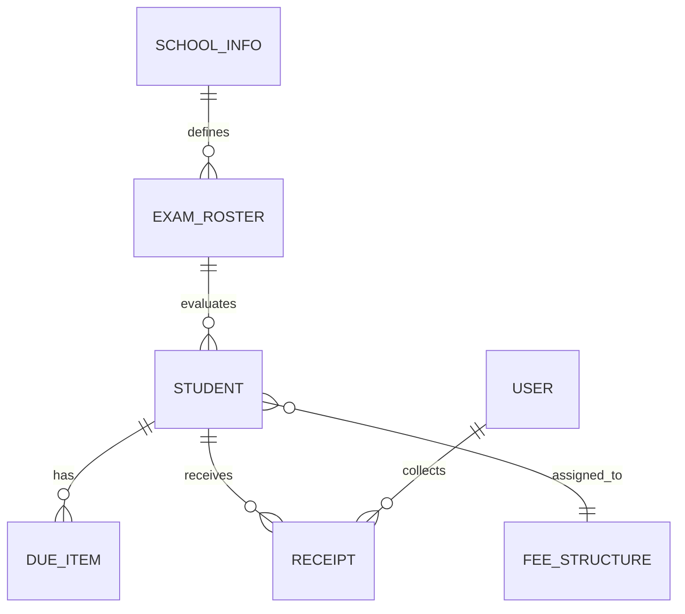

# Backend Data Schema & Entity Specifications
## Project: School Finance OS

---

## 1. Entity-Relationship Overview



---

## 2. Entity Schemas

### 2.1 Student Entity (`students.json`)
```typescript
interface Student {
  id: string;                    // Unique UUID (e.g. "std-2026-001")
  admissionNo: string;           // School admission registry number
  rollNo?: string;               // Class roll number
  name: string;                  // Full student name
  gender: "MALE" | "FEMALE";     // Gender
  class: string;                 // e.g. "LKG", "1", "10"
  section: string;               // e.g. "A", "B"
  admissionDate?: string;        // ISO 8601 Date
  dob?: string;                  // Date of birth (YYYY-MM-DD)
  fatherName?: string;           // Father's name
  motherName?: string;           // Mother's name
  fatherMobile?: string;         // Primary contact number
  motherMobile?: string;         // Secondary contact number
  parentPhone?: string;          // Generic fallback contact
  address?: string;              // Residential address
  transportRoute?: string;       // Transport pickup zone
  siblingIds?: string[];         // Linked sibling student IDs
  feeStructureId?: string;       // Custom assigned fee plan ID
  concessionPercent?: number;    // Base tuition waiver percentage
  isActive: boolean;             // Active enrollment status
  createdAt: string;             // ISO timestamp
  updatedAt: string;             // ISO timestamp
}
```

### 2.2 Due Item Entity (`billing.json -> dueItems`)
```typescript
interface DueItem {
  id: string;                    // Unique UUID
  studentId: string;             // Foreign Key -> Student.id
  head: string;                  // Fee Head: "Tuition", "Exam", "Transport", etc.
  amount: number;                // Amount in integer Paise (e.g. 150000 = ₹1,500.00)
  month: string;                 // Due period: "Apr", "May", "Annual", etc.
  dueDate: string;               // ISO 8601 Date
  status: "PAID" | "UNPAID" | "PARTIAL";
  academicYear: string;          // Academic session (e.g. "2026-2027")
  notes?: string;                // Operational remarks
}
```

### 2.3 Receipt Voucher Entity (`billing.json -> receipts`)
```typescript
interface Receipt {
  id: string;                    // Unique UUID
  receiptNo: string;             // Human-readable voucher (e.g. "REC-202610-0042")
  studentId: string;             // Foreign Key -> Student.id
  studentName: string;           // Denormalized for rapid historical rendering
  classSection: string;          // Denormalized class name
  amount: number;                // Total collected in integer Paise
  method: "CASH" | "UPI" | "BANK" | "CHEQUE";
  referenceNo?: string;          // Cheque number or UPI UTR reference
  receivedBy: string;            // Cashier username / User.id
  timestamp: string;             // ISO timestamp
  status: "ACTIVE" | "REVERSED"; // Immutability flag
  reversalReason?: string;       // Required if status is REVERSED
  itemsCovered: Array<{
    dueItemId: string;
    head: string;
    amountPaid: number;          // In integer Paise
  }>;
}
```

### 2.4 Exam Marks Evaluation Entity (`marks.json` or `/api/marks`)
```typescript
interface StudentMarksEntry {
  marksObtained: string;         // String to support decimal (e.g. "18.5")
  breakdown?: Record<string, string>; // e.g. { "Theory": "14", "Practical": "4.5" }
  isAbsent?: boolean;            // Flag for student absence
  remarks?: string;              // Evaluator note
}

interface ExamMarksRoster {
  examName: string;              // e.g. "Unit-1", "Half-Yearly"
  classId: string;               // e.g. "LKG-A"
  subject: string;               // e.g. "ENGLISH"
  maxMarks: number;              // Total evaluation ceiling
  splitComponents?: Array<{
    name: string;                // e.g. "Theory"
    max: number;                 // e.g. 15
  }>;
  roster: Record<string, StudentMarksEntry>; // studentId -> MarksEntry
  updatedAt: string;             // Last sync timestamp
}
```

### 2.5 School Settings Profile (`school.json`)
```typescript
interface SchoolInfo {
  name: string;                  // Official school display name
  tagline?: string;              // Subtitle on vouchers
  address: string;               // Physical school campus address
  phone: string;                 // Official contact phone
  email?: string;                // Official contact email
  logoUrl?: string;              // Optimized WebP / PNG logo path
  upiId: string;                 // Official VPA (Empty string if unconfigured)
  academicSession: string;       // e.g. "2026-2027"
  lockedExams: string[];         // Array of exams locked against modification
}
```

### 2.6 User Credentials & Security Entity (`users.json`)
```typescript
interface UserAccount {
  id: string;                    // Unique UUID
  username: string;              // Unique login identifier
  name: string;                  // Staff full name
  role: "ADMIN" | "ACCOUNTANT" | "TEACHER";
  passwordHash: string;          // Salted hash
  tokenVersion: number;          // Incremented to revoke all active JWT tokens
  isActive: boolean;             // Account block flag
  createdAt: string;
}
```
