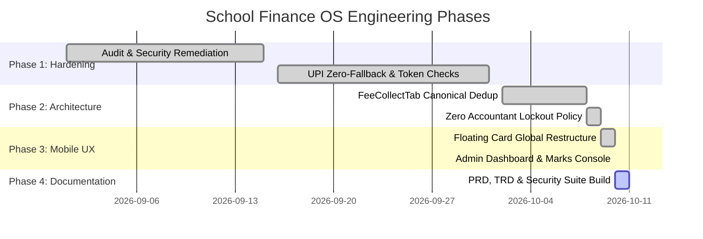

# Implementation Plan & Operational Roadmap
## Project: School Finance OS

---

## 1. Roadmap & Milestone Summary



---

## 2. Completed Milestones

### Milestone 1: Security & Financial Hardening
- [x] **Hardcoded UPI Elimination**: Removed static fallback `8423926608@upi`. Replaced with strict `hasUpiConfigured` conditional guards to prevent fund misdirection.
- [x] **Integer Paisa Precision**: Standardized financial accounting to integer Paise via `toPaisa()`.
- [x] **Session Revocation via `tokenVersion`**: Implemented instant multi-device token invalidation upon password reset, logout, or account block.
- [x] **Bounded LRU Cache**: Implemented `BoundedCache(50, ...)` to eliminate memory leaks.

### Milestone 2: Deduplication & Unified Architecture
- [x] **Canonical Fee Collect Hub**: Consolidated redundant 95KB duplicate components into `src/components/shared/FeeCollectTab.tsx`. Both Admin and Accountant dashboards import the single canonical source.
- [x] **Unrestricted Accountant Policy**: Maintained full cashier trust for discount, waivers, and counter operations as explicitly directed by school management.

### Milestone 3: Mobile-First Floating UI Overhaul
- [x] **Global CSS Overrides Cleaned**: Removed destructive `border-radius: 0` and flat-card overrides from `globals.css`.
- [x] **Dashboard Overview Tab**: 2x2 symmetrical KPI grids, full-bleed Quick Command Hub, responsive monthly fee curve, mobile receipt card feed.
- [x] **Student Marks Feeding Console**: Full-bleed swipeable action strip, clean `🔒` indicators, sticky floating bar synced with `--bottom-nav-height`.
- [x] **Directory & Defaulters Ledgers**: Mobile-optimized high-density card layouts with direct 1-click WhatsApp messaging.

---

## 3. Verification & Quality Assurance Protocols

Every subsequent PR or codebase update must pass the following 3-step verification:

```bash
# Step 1: Strict TypeScript Typecheck (Must exit with code 0)
npx tsc --noEmit

# Step 2: Secret & UPI Safety Verification
# Ensure no hardcoded VPAs exist in components
git grep -i "8423926608"

# Step 3: Mobile Viewport Inspection
# Test on simulated 360px x 640px viewport for text cutoffs or clipping
```
