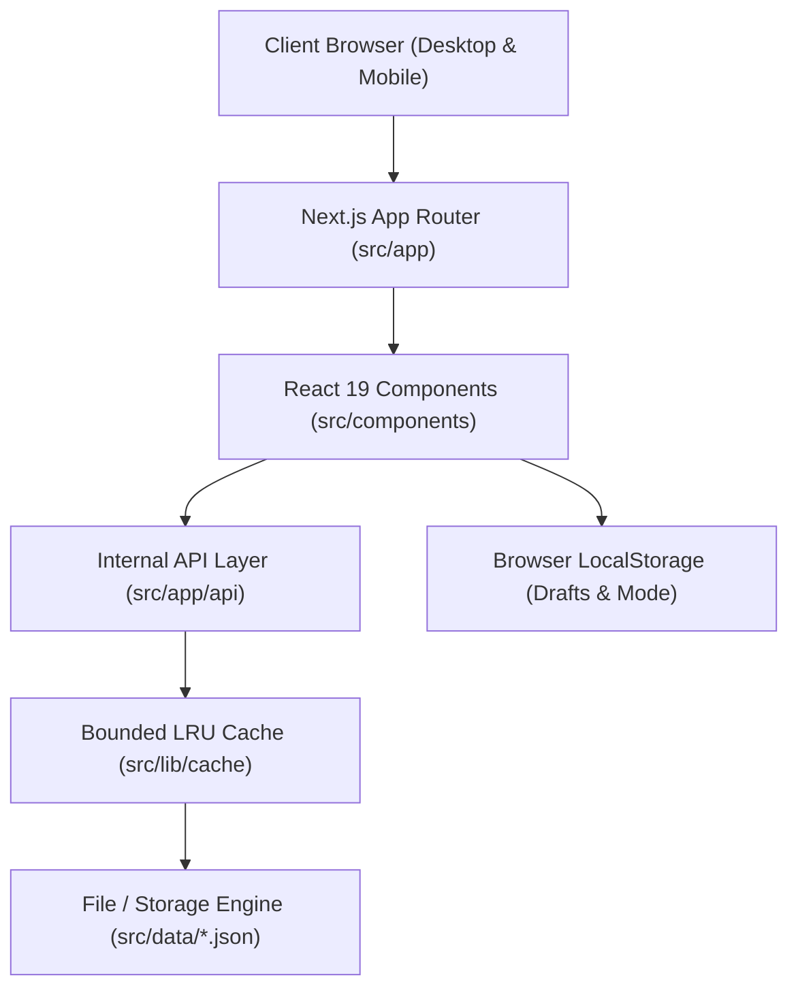

# Technical Requirements Document (TRD)
## Project: School Finance OS

---

## 1. System Architecture Overview

School Finance OS is constructed as a monolithic, high-efficiency Next.js application leveraging modern Server-Side APIs and Client-Side Interactive Components.



---

## 2. Technology Stack

- **Framework**: Next.js (App Router, React Server Components + Client Islands).
- **Core Library**: React 19 (`useState`, `useMemo`, `useCallback`, `useTransition`).
- **Language**: TypeScript 5.x (`strict: true`, zero `tsc` error policy).
- **Styling Engine**: Tailwind CSS v3/v4 with custom CSS utility extensions (`globals.css`).
- **Icons**: `lucide-react`.
- **Packaging & Serving**: Node.js 20+ runtime with Turbopack / Webpack development tooling.

---

## 3. Financial Calculation Standards

To eliminate IEEE 754 floating-point precision drift in financial records:
1. **Integer Paisa Storage**:
   - All dues, receipt amounts, discounts, and payments are normalized to **Paise** (`1 Rupee = 100 Paise`) before storage and computation.
   - Utility: `toPaisa(rupeeAmount)` -> converts `150.50` into integer `15050`.
2. **Display Formatting**:
   - `formatP(paiseAmount)` converts Paise back to formatted Indian Rupee strings (`₹1,500.50`).
3. **Receipt Immutability**:
   - Active receipts cannot be edited in place. Any correction must be performed via an explicit `REVERSED` status transition accompanied by an audit trail.

---

## 4. Date & Timezone Integrity (IST)

Schools operate under Indian Standard Time (`IST`, UTC+5:30).
- **Anti-Pattern Forbidden**: `new Date().toISOString().split('T')[0]` executes in UTC and causes date rollbacks for counter receipts created between 00:00 and 05:30 IST.
- **Mandated Utility**: `getTodayIST()` (or `Intl.DateTimeFormat('en-CA', { timeZone: 'Asia/Kolkata' })`) must be used for all date boundaries, fee due checks, and counter timestamps.

---

## 5. Caching & Data Persistence Layer

### 5.1 In-Memory Bounded Cache (`BoundedCache`)
- Unbounded in-memory caches cause process memory exhaustion on long-running school servers.
- `src/lib/cache/billingCache.ts` enforces `BoundedCache(50, ...)` with an LRU eviction strategy.

### 5.2 Storage Engine
- Operational datasets are persisted in atomic JSON files located under `src/data/`:
  - `students.json`: Student demographic and academic profiles.
  - `billing.json`: Due items, ledger vouchers, and receipts.
  - `school.json`: School profile, configuration, and exam locking parameters.
  - `users.json`: Staff access credentials, assigned roles, and `tokenVersion`.

---

## 6. Mobile-First Responsive Design System

### 6.1 Floating Card Architectural Standard
On viewports `< 768px` (`sm:` breakpoint):
- Container background: `bg-slate-50`.
- Card elements: `bg-white rounded-2xl border-0 sm:border border-slate-200/80 shadow-sm`.
- Avoid destructive global flat card overrides (`border-radius: 0 !important` is strictly prohibited).

### 6.2 Full-Bleed Action Strips
- Horizontal filter strips, pill navigations, and quick command hubs must bleed smoothly to mobile screen borders:
  ```tsx
  className="-mx-3 px-3 sm:mx-0 sm:px-0 flex items-center gap-2 overflow-x-auto scrollbar-none no-scrollbar"
  ```
- Always append a trailing spacer `<div className="w-2 shrink-0 sm:hidden" />` to guarantee the last pill doesn't clip on device bevels.

### 6.3 Sticky Bar Alignment
- Sticky mobile floating action bars must sit above the native bottom navigation bar:
  ```css
  bottom: calc(var(--bottom-nav-height, 64px) + var(--safe-bottom, 0px));
  ```
- Content viewports must maintain bottom padding (`pb-28` to `pb-32`) to prevent last items from being obscured.

---

## 7. Build & Quality Verification

All proposed changes must strictly pass:
```bash
npx tsc --noEmit
```
With exit code `0` and zero diagnostics.
