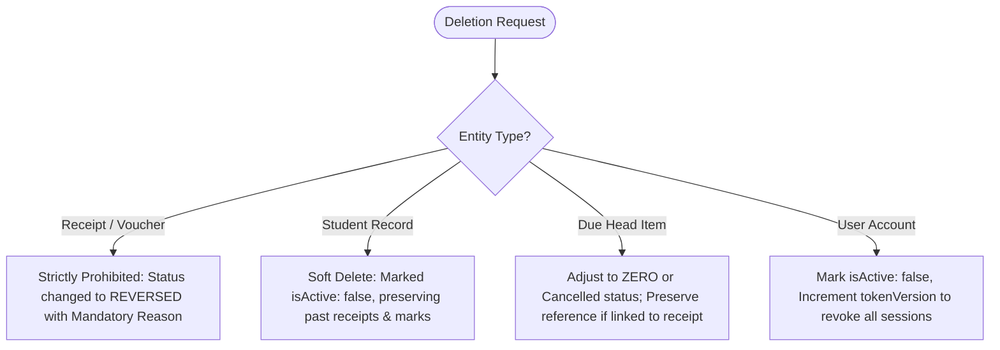

# Safe Delete & Audit Immutability Policy
## Project: School Finance OS

---

## 1. Core Principle: Financial Records Immutability

In school accounting, **physical deletion of financial transactions is considered audit tampering**. Every Rupee collected or adjusted must leave an unbroken audit trail for statutory compliance and school board inspection.

---

## 2. Entity-Specific Deletion Rules

### 2.1 Fee Receipts & Vouchers
- **Hard Deletion**: **STRICTLY PROHIBITED**.
- **Reversal Protocol**:
  - If a receipt is issued by mistake (e.g. wrong student selected or duplicate cash entry), the cashier or admin must trigger a **Reversal**.
  - Status transitions from `ACTIVE` to `REVERSED`.
  - A mandatory `reversalReason` must be entered (e.g. "Cheque bounced" or "Duplicate cash entry").
  - The reversed receipt remains visible in the ledger report for accounting transparency.
  - The linked due items are automatically restored to `UNPAID` status.

### 2.2 Student Records
- **Hard Deletion**: Not permitted if the student has past receipts or academic marksheets.
- **Archive Protocol**:
  - Student is marked `isActive: false`.
  - The student ceases to appear in active roll calls and active class lists.
  - All past fee vouchers and report cards remain permanently accessible in historical reports.

### 2.3 User Accounts
- **Hard Deletion**: Permitted only for test accounts with zero associated receipt vouchers.
- **Deactivation Protocol**:
  - `isActive = false`
  - `tokenVersion += 1`
  - Immediately terminates active sessions and prevents further logins.

---

## 3. Database Reset & Disaster Recovery
- Any bulk reset operation (e.g. start of new academic session) must generate an automated timestamped backup JSON snapshot in a local `/backups/` directory prior to clearing data.
