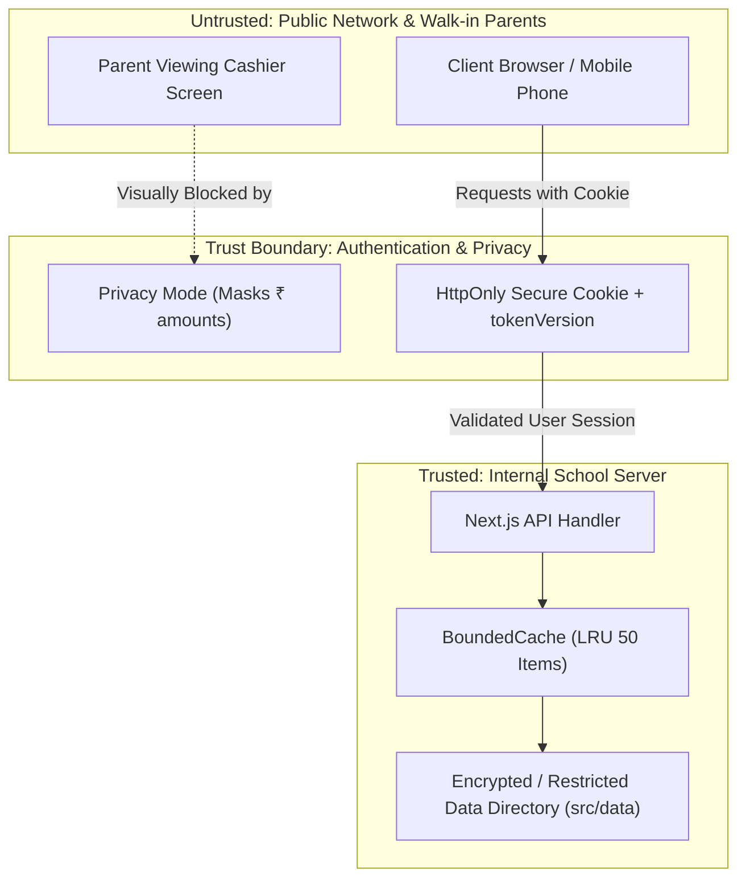

# Threat Model Document
## Project: School Finance OS

---

## 1. STRIDE Threat Analysis

| Threat Category | Description in School Context | Mitigation Implemented |
| :--- | :--- | :--- |
| **S - Spoofing** | Attacker impersonates an accountant or school admin to access student records or steal collections. | JWT authentication verified via `tokenVersion` stored in `users.json`. Any credential change invalidates all existing sessions immediately. |
| **T - Tampering** | Manipulating student fee balances, altering receipts, or modifying exam marks in transit. | Integer Paise computation (`toPaisa`), immutable receipts (`status: ACTIVE \| REVERSED`), and locked exams policy (`lockedExams`). |
| **R - Repudiation** | An accountant denies collecting fee cash from a parent. | Every voucher records `receivedBy`, timestamp in IST, sequential `receiptNo`, and creates an immutable audit trail entry. |
| **I - Information Disclosure** | Leaking parent phone numbers, student addresses, or overall daily school revenue to visitors. | Global Privacy Mode (`privacyMode`) masks financial totals with `₹••••••`. Strict server-side route filtering prevents exposing password hashes. |
| **D - Denial of Service** | Exhausting server memory or freezing the browser counter during busy admission mornings. | `BoundedCache(50)` enforces strict in-memory size limits with LRU eviction. LocalStorage caching ensures UI remains responsive even on network hiccups. |
| **E - Elevation of Privilege** | An unauthorized user executes administrative tasks (e.g. wiping database or changing school UPI ID). | Server-side role checks on critical endpoints (`/api/school`, `/api/users`). Sensitive settings restricted to `ADMIN` role. |

---

## 2. Trust Boundaries & Data Flow

---

## 3. High-Priority Threat Scenarios & Countermeasures

### 3.1 Fund Misdirection via Malicious UPI ID
- **Threat**: An attacker modifies the UPI configuration to their personal address, causing parents' digital fee payments to be credited to a thief's account.
- **Countermeasure**:
  - Zero hardcoded fallback UPI IDs anywhere in client or server code.
  - If `school.upiId` is blank or unconfigured, the UPI payment tab automatically disables QR generation and alerts the cashier.
  - School settings can only be altered by authenticated administrators.

### 3.2 Stale Session Reuse after Staff Termination
- **Threat**: A terminated accountant continues collecting fees or downloading student lists using an active JWT token on their phone.
- **Countermeasure**:
  - The `/api/auth/me` guard compares the JWT's embedded `tokenVersion` against the database's live `tokenVersion`.
  - Blocking the user or resetting their password increments `tokenVersion`, invalidating all tokens immediately across all devices.
